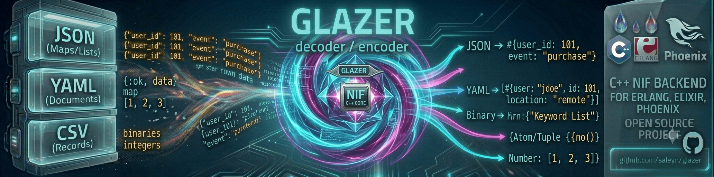
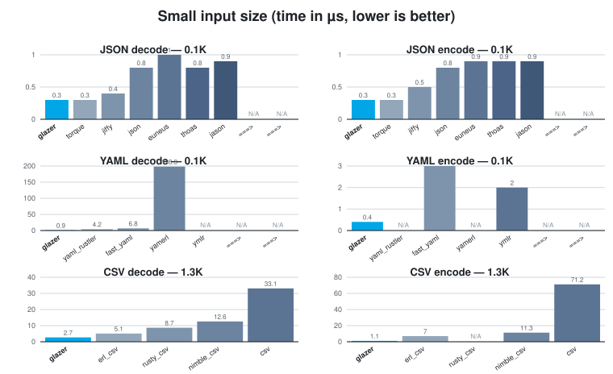
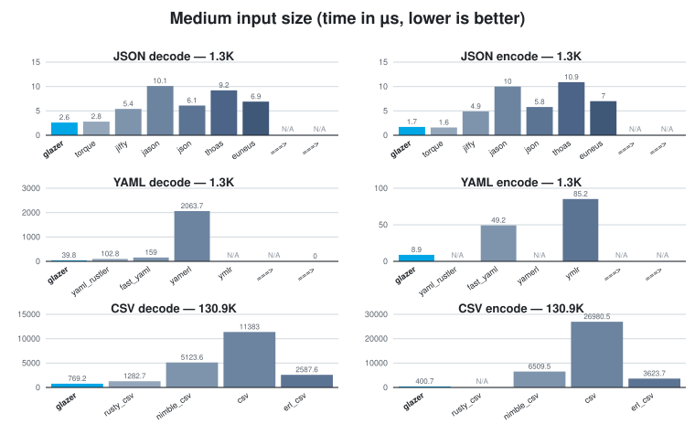
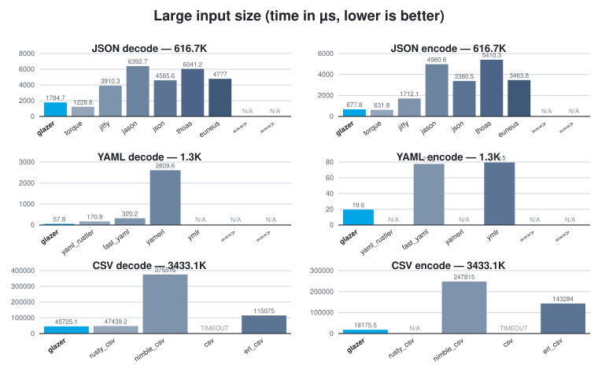

[](https://github.com/saleyn/glazer/actions/workflows/erlang.yaml)
[](https://hex.pm/packages/glazer)
[](https://hex.pm/packages/glazer)

`glazer` - fast Erlang NIF encoder/decoder for **JSON**, **YAML**, and **CSV**,
built around hand-rolled recursive-descent decoders and direct
term-to-text encoders that produce/consume native Erlang terms in a
single pass. The JSON implementation was inspired by the
[glaze](https://github.com/stephenberry/glaze) C++ library; `glazer` has
since matured into a standalone implementation with no external C++
dependencies, and extended the same approach to YAML and CSV, with
performance and features unmatched by other existing libraries for these
formats.

It also has **jq-style filters** for JSON (`query/2,3`, see [jq filter support](guides/json.md#jq-filter-support)),
and **JSON Schema 2020-12 validation** for JSON and YAML documents, with a schema registry
(see [JSON Schema validation](#json-schema-validation)).

Full documentation: [see hexdocs](https://glazer.hexdocs.pm/).

## Table of contents

- [Table of contents](#table-of-contents)
- [Features](#features)
  - [JSON](#json)
  - [YAML](#yaml)
  - [CSV](#csv)
- [Installation](#installation)
  - [Building](#building)
  - [Testing](#testing)
- [Performance](#performance)
- [JSON](#json-1)
- [YAML](#yaml-1)
- [CSV](#csv-1)
- [JSON Schema validation](#json-schema-validation)
  - [Quick start](#quick-start)
- [Big integers](#big-integers)
  - [API](#api)
- [Limitations](#limitations)
  - [Scope](#scope)
  - [Nesting depth](#nesting-depth)
  - [Schema validation](#schema-validation)
- [License](#license)

## Features

### JSON

- Decoding straight to Erlang terms: maps, lists, binaries, integers
  (including bignums), floats, booleans, and `null`
- Encoding Erlang terms straight to JSON, including big integers
- Encoding a list of Erlang terms to newline-delimited JSON
- Incremental/streaming decoding of partial input (e.g. NDJSON over a
  socket) via `decode_start/3`, `decode_continue/2`
- Configurable representation of JSON `null` and JSON object keys
- `minify/1` and `prettify/1` helpers
- Standalone big-integer encode/decode helpers
  (`encode_integer/1`, `decode_integer/1`, `try_decode_integer/1`)
- `query/2,3`: run a [jq](https://jqlang.org/) filter over a JSON
  document, returning decoded Erlang terms (requires `glazer` to be built
  with `libjq` available — see [jq filter support](guides/json.md#jq-filter-support))
- `glazer:find/2` and `glazer:compile_path/1`: look up value(s) in a
  decoded term using a small subset of jq path syntax (`.a.b[].c[0]`),
  with no `libjq` dependency
- Support native Erlang and Elixir API via `glazer_json` and `Glazer.JSON` modules

### YAML

- Decoding YAML mappings/sequences/scalars to Erlang maps/lists/scalars,
  including big integers
- Encoding Erlang terms to YAML in block style
- Configurable representation of YAML `null` and mapping keys, with
  optional YAML 1.1 boolean compatibility (`yes`/`no`/`on`/`off`)
- Support native Erlang and Elixir API via `glazer_yaml` and `Glazer.YAML` modules

### CSV

- RFC 4180 CSV encoding/decoding via `decode/1,2` and `encode/1,2`,
  with optional header-row support
- Incremental/streaming CSV decoding via `decode_start/3`,
  `decode_continue/2`
- Support native Erlang and Elixir API via `glazer_csv` and `Glazer.CSV` modules

## [Installation](#table-of-contents)

**Erlang (`rebar.config`)**:

**Erlang**

```erlang
{deps, [
  {glazer, "~> 1.0"}
]}.
```

**Elixir (`mix.exs`)**:

The project comes with `rebar.config`, and `mix.exs`. The later project file is for
compiling it as a dependency in Elixir projects, and requires an explicit `manager: :mix`
instruction:

```elixir
def deps do
  [
    {:glazer, "~> 1.0", manager: :mix}
  ]
end
```

### [Building](#table-of-contents)

Building the NIF requires a C++23 compiler (GCC 12+ or Clang 16+) and
`make`. There are no external C++ library dependencies — all C++ code is
self-contained in `c_src/`. A plain

```sh
make
```

builds `priv/glazer.so` and compiles the Erlang sources. For the fastest
performance, run a Profile-Guided Optimisation (PGO) build instead:

```sh
make optimize
```
or
```sh
OPTIMIZE=1 make
```

This performs three steps automatically: compiles an instrumented binary,
runs the test suite to collect real branch-frequency data, then recompiles
with those profiles applied. The resulting `.so` typically outperforms a
plain `-O3` build by 5–15% on realistic JSON workloads.

`glazer` is an Erlang application with a Rebar-based C++ NIF build;
`mix` invokes the same top-level `Makefile`/`rebar3 compile` path
described above, so the same C++23 compiler requirement applies.
Once compiled, call it via the `:glazer` module from Elixir:

**Erlang**

```erlang
1> glazer_json:decode(~"{\"a\":1,\"b\":[true,null,3.5]}")
#{<<"a">> => 1,<<"b">> => [true,null,3.5]}
2> :glazer_json.encode(#{"a" => 1, "b" => [true, :null, 3.5]})
"{\"a\":1,\"b\":[true,null,3.5]}"
```

**Elixir**

```elixir
iex> Glazer.JSON.decode!(~s({"a":1,"b":[true,null,3.5]}))
%{"a" => 1, "b" => [true, nil, 3.5]}
> Glazer.JSON.encode(%{"a" => 1, "b" => [true, nil, 3.5]})
"{\"a\":1,\"b\":[true,null,3.5]}"
```

Use the `use_nil`/`{null, nil}` option (see
[Null term configuration](guides/json.md#null-term-configuration) below) to get idiomatic Elixir `nil` instead of the atom `:null`.

### [Testing](#table-of-contents)

```sh
make test
```

runs the EUnit test suite via `rebar3 eunit`.

## Performance

- **[JSON](guides/json.md#benchmarking-json)**: faster than almost every library benchmarked on
  both encoding and decoding. It's competitive with `torque` (Rust `sonic-rs` NIF)
  JSON-only library, and well ahead of `simdjsone`, `jiffy`, and the
  pure-Elixir libraries `jason`, `thoas`, `euneus`, and OTP's built-in `json`.
- **[YAML](guides/yaml.md#benchmarking-yaml)**: 2–7× faster than `yaml_rustler` and
  `fast_yaml`, and ~25–75× faster than the pure-Erlang `yamerl`/`ymlr`.
- **[CSV](guides/csv.md#benchmarking-csv)**: 4–12× faster than `nimble_csv`, and tens to
  hundreds of times faster than `csv` and `erl_csv` (which time out on
  large inputs).





Each chart compares glazer against other libraries for JSON/YAML/CSV
decode and encode on a representative small/medium/large file. Charts are
generated from the tables below via `scripts/gen_bench_charts.py`.

Benchmarking data tables:
- [Benchmarking JSON](guides/json.md#benchmarking-json)
- [Benchmarking YAML](guides/yaml.md#benchmarking-yaml)
- [Benchmarking CSV](guides/csv.md#benchmarking-csv)

## [JSON](#table-of-contents)

Fast JSON encoding and decoding, with streaming, options, jq filters and Elixir
protocol support. The full reference is in [guides/json.md](guides/json.md).

**Erlang**

```erlang
1> glazer_json:decode(<<"{\"a\":1,\"b\":[true,null,3.5]}">>).
#{<<"a">> => 1, <<"b">> => [true, null, 3.5]}
```

**Elixir**

```elixir
iex> Glazer.JSON.decode!(~s({"a":1,"b":[true,null,3.5]}))
%{"a" => 1, "b" => [true, nil, 3.5]}
```

## [YAML](#table-of-contents)

YAML decoding and encoding, with the same option style as JSON. The full
reference is in [guides/yaml.md](guides/yaml.md).

**Erlang**

```erlang
1> glazer_yaml:decode(<<"a: 1\nb:\n  - true\n  - null\n  - 3.5\n">>).
#{<<"a">> => 1, <<"b">> => [true, null, 3.5]}
```

**Elixir**

```elixir
iex> Glazer.YAML.decode!("a: 1\nb:\n  - true\n  - null\n  - 3.5\n")
%{"a" => 1, "b" => [true, :null, 3.5]}
```

## [CSV](#table-of-contents)

CSV decoding and encoding, with headers, typed fields and streaming. The full
reference is in [guides/csv.md](guides/csv.md).

**Erlang**

```erlang
1> glazer_csv:decode(<<"name,age\nAlice,30\n">>, [headers, {return, map}]).
#{headers => [<<"name">>,<<"age">>],
  data    => [#{<<"name">> => <<"Alice">>, <<"age">> => <<"30">>}]}
```

**Elixir**

```elixir
iex> Glazer.CSV.decode!("name,age\nAlice,30\n", [:headers, {:return, :map}])
%{headers: ["name", "age"], data: [%{"name" => "Alice", "age" => "30"}]}
```

## [JSON Schema validation](#table-of-contents)

Compile and validate JSON and YAML documents against JSON Schema 2020-12, with
a schema registry. The full guide is in [guides/json-validation.md](guides/json-validation.md).

### Quick start

**Erlang**

```erlang
Schema = #{
  ~"type"       => ~"object",
  ~"required"   => [~"name"],
  ~"properties" => #{
    ~"name" => #{~"type" => ~"string", ~"minLength"  => 1}
  }
},

{ok, Compiled} = glazer_schema:compile(Schema),
ok = glazer_schema:validate(Compiled, #{~"name" => ~"Ann"}),
{error, {path, [~"name"], {string_too_short, ~""}}} =
  glazer_schema:validate(Compiled, #{~"name" => ~""}).
```

**Elixir**

```elixir
schema = %{
  "type"       => "object",
  "required"   => ["name"],
  "properties" => %{"name" => %{"type" => "string", "minLength" => 1}}
}

{:ok, compiled} = Glazer.Schema.compile(schema)
:ok = Glazer.Schema.validate(compiled, %{"name" => "Ann"})
{:error, {:path, ["name"], {:string_too_short, ""}}} = Glazer.Schema.validate(compiled, %{"name" => ""})
```

Decoded JSON uses `nil` for `null`, so set `config :glazer, null: nil` to validate such data (see the moduledoc).

## [Big integers](#table-of-contents)

JSON/YAML/CSV numbers that don't fit into a 64-bit integer are decoded as
Erlang big integers (and big integers are encoded back to their exact
decimal representation). The conversion routines are also available on their own.

### API

| Erlang | Elixir | Description |
|---|---|---|
| `glazer:encode_integer/1` | `Glazer.encode_integer!/1` | Encode an integer to its decimal string (raises `ArgumentError` in Elixir for a non-integer). |
| `glazer:decode_integer/1` | `Glazer.decode_integer!/1` | Decode a decimal string to an integer, raising on invalid input (`Glazer.ParseError` in Elixir). |
| `glazer:try_decode_integer/1` | `Glazer.decode_integer/1` | Decode a decimal string, returning `{ok, Int}` or `{error, invalid_number_format}` (`{:ok, int}` or `{:error, :invalid_number_format}` in Elixir). |

**Erlang**

```erlang
1> glazer:encode_integer(123456789012345678901234567890).
<<"123456789012345678901234567890">>

2> glazer:decode_integer(<<"123456789012345678901234567890">>).
123456789012345678901234567890

3> glazer:try_decode_integer(<<"not a number">>).
{error, invalid_number_format}
```

**Elixir**

```elixir
iex> Glazer.encode_integer!(123456789012345678901234567890)
"123456789012345678901234567890"

iex> Glazer.decode_integer!("123456789012345678901234567890")
123456789012345678901234567890

iex> Glazer.decode_integer("not a number")
{:error, :invalid_number_format}
```

See the module's documentation (`src/glazer.erl`, and `lib/glazer.ex` for Elixir) for full type
specs and details.

## [Limitations](#table-of-contents)

### Scope

`glazer` targets formats that map naturally onto a tree of Erlang
maps/lists/scalars — JSON and YAML both fit this model directly, so a
single decode/encode pair can convert losslessly between the format and
native terms. XML is intentionally **not** planned: its data model
(tagged elements, attributes, mixed text/element content, namespaces,
processing instructions, entities) has no single natural Erlang term
representation, and any choice (xmerl-style tuples, JSON-like maps with
`@attr`/`#text` keys, etc.) is a lossy or awkward fit compared to formats
that are already trees of scalars and collections. Erlang's standard
library already ships `xmerl` for XML; there's little value in
duplicating it here with a different, opinionated term shape.

### Nesting depth

The JSON and YAML decoders both cap recursion at **256 levels** of nesting
(arrays/objects for JSON; mappings/sequences for YAML). Inputs that exceed
this limit are rejected with a decode error rather than crashing the VM by
overflowing the C stack.

| Format | Limit | Error returned |
|--------|-------|----------------|
| JSON   | 256   | `{error, <<"exceeded maximum nesting depth at offset N">>}` |
| YAML   | 256   | `{error, <<"exceeded maximum nesting depth at offset N">>}` |

256 levels is sufficient for any reasonable real-world document; it is
deliberately not configurable, because the limit exists to protect the
Erlang VM process (the NIF runs on the scheduler thread) from runaway
recursive descent on adversarial input.

### Schema validation

The known gaps of schema validation (decimals beyond double precision, float `multipleOf`
tolerance, and regex engine differences) are in
[guides/json-validation.md](guides/json-validation.md#limits-known-issues-and-what-is-not-supported).

## License

Glazer uses [MIT License](LICENSE). You can use the source code freely
in any project, including commercial applications, as long as you give
credit by publishing the contents of the LICENSE file somewhere in your
documentation.
